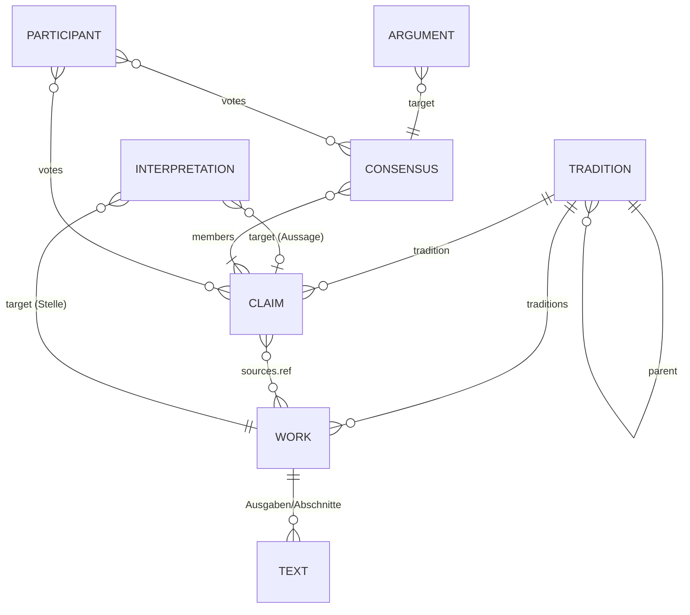

# OpenReligion – Datenmodell

Die verbindliche Definition sind die JSON-Schemas in [`schema/`](../schema). Dieses Dokument
erklärt sie. Begründungen stehen in [konzept.md](konzept.md).

## Überblick



| Schicht | Typ | Format | Ort | Schema |
|---|---|---|---|---|
| Religion | `tradition` | Markdown | `data/traditions/<pfad>.md` | [tradition](../schema/tradition.schema.json) |
| Daten | `work` | Markdown | `data/works/<slug>.md` | [work](../schema/work.schema.json) |
| Daten | Text | JSON | `data/texts/<werk>/<ausgabe>/<abschnitt>.json` | [text](../schema/text.schema.json) |
| Religion | `claim` | Markdown | `data/claims/<pfad>.md` | [claim](../schema/claim.schema.json) |
| Religion | `interpretation` | Markdown | `data/interpretations/<pfad>.md` | [interpretation](../schema/interpretation.schema.json) |
| Konsens | `argument` | Markdown | `data/arguments/<pfad>.md` | [argument](../schema/argument.schema.json) |
| Konsens | `consensus` | Markdown | `data/consensus/<pfad>.md` | [consensus](../schema/consensus.schema.json) |
| Konsens | Teilnehmende + Stimmen | JSON | `data/participants/<login>.json` | [participant](../schema/participant.schema.json) |
| Konsens | Regeln | JSON | `config/consensus.json` | – |
| Ausgabe | Export, Ergebnisse | JSON/JSONL | `dist/` (generiert) | – |

## Kennungen

### Entitäts-IDs

```
<typ>:<slug>/<slug>/…        slug = [a-z0-9]+(-[a-z0-9]+)*
```

Die ID bestimmt die Datei, und der Validator erzwingt das:

| ID | Datei |
|---|---|
| `tradition:monotheism/divine/islam` | `data/traditions/monotheism/divine/islam.md` |
| `claim:islam/tawhid` | `data/claims/islam/tawhid.md` |
| `consensus:ethics/golden-rule` | `data/consensus/ethics/golden-rule.md` |

Traditions-IDs bilden den Baum ab. Bei Aussagen, Auslegungen usw. ist der Pfad nur eine
Ordnungshilfe; die Zuordnung zur Tradition steht immer explizit im Feld `tradition`.

### Stellenangaben

```
<werk-id>#<locus>            work:bible#Matt.7.12 · work:quran#112.1-4 · work:bavli#Shabbat.31a
```

Gültige Loci definiert jedes Werk in `citation.locus_pattern` (regulärer Ausdruck).

## Gemeinsame Bausteine

Definiert in [`common.schema.json`](../schema/common.schema.json).

| Baustein | Form | Beispiel |
|---|---|---|
| Mehrsprachiger Text | Objekt Sprachcode → Text, mindestens eine Sprache | `statement: { de: "…", en: "…" }` |
| Beleg (`source`) | genau eins von `ref` (Stelle) oder `citation` (Literatur), optional `note` | `- ref: work:bible#Matt.7.12` |
| Relation | `type` + `target` (+ `note`) | `- type: parallels`<br>`  target: claim:islam/golden-rule-hadith` |
| Prüfstatus | `draft` · `reviewed` · `disputed` · `deprecated` | `review_status: draft` |

**Relationstypen:** `parallels` und `contradicts` und `same-as` sind symmetrisch (eine Richtung
eintragen genügt, der Export ergänzt die Gegenrichtung); `refines`, `derives-from`,
`supports`, `challenges` sind gerichtet.

## Entitäten

### `tradition` – Knoten der Religionsschicht

| Feld | Pflicht | Bedeutung |
|---|---|---|
| `kind` | ja | `category` (Strukturknoten) · `tradition` · `branch` (Strömung) · `school` |
| `name` | ja | mehrsprachig |
| `parent` | außer Wurzelkategorien | primäre Einordnung |
| `also_in` | | sekundäre Einordnungen |
| `facets.theism` | | mehrere aus `monotheism`, `polytheism`, `henotheism`, `monism`, `pantheism`, `panentheism`, `dualism`, `nontheism`, `atheism`, `agnosticism`, `animism` |
| `facets.orientation` | | `divine` · `adversary` (nur Monotheismus) |
| `facets.epistemic_basis` | | `scripture` · `tradition` · `reason` · `experience` · `empirical` |
| `external_ids.wikidata` | | z. B. `Q432` |

### `work` – Textwerk

| Feld | Pflicht | Bedeutung |
|---|---|---|
| `title`, `traditions` | ja | |
| `citation.locus_pattern`, `citation.example` | ja | Zitierschema als Regex + Beispiel |
| `citation.standard` | | OSIS, Sefaria, SuttaCentral … |
| `editions[]` | ja | `id`, `lang`, `title`, **`license`** (`public-domain` · `cc0` · `cc-by` · `cc-by-sa` · `other` · `reference-only`), `in_corpus` |

### Text – Volltext eines Abschnitts (JSON)

```json
{
  "type": "text",
  "work": "work:bible",
  "edition": "kjv",
  "lang": "en",
  "division": "Matt.7",
  "complete": false,
  "segments": [{ "locus": "Matt.7.12", "text": "Therefore all things whatsoever …" }]
}
```

`work`, `edition` und `division` müssen zum Dateipfad passen; Ausgaben mit
`license: reference-only` dürfen keinen Volltext haben.

### `claim` – Aussage

Das zentrale Element. Eine Aussage ist immer **zugeschrieben**: Gelesen wird sie als
„Laut *tradition* (*perspective*) gilt: *statement*“.

| Feld | Pflicht | Werte |
|---|---|---|
| `tradition` | ja | Traditions-ID |
| `perspective` | ja | `internal` (Selbstbeschreibung) · `external` (Fremdbeschreibung) · `scholarly` |
| `claim_type` | ja | `descriptive` · `normative` · `metaphysical` · `empirical` · `historical` |
| `epistemic_basis` | ja | Liste aus `scripture` · `tradition` · `reason` · `experience` · `empirical` |
| `statement` | ja | mehrsprachig, ohne „laut X“ |
| `sources` | bei `empirical` | Belege |
| `evidence.level` | bei `empirical` | `established` · `supported` · `preliminary` · `contested` · `refuted` |
| `relations` | | |

Beispiel: [`data/claims/islam/tawhid.md`](../data/claims/islam/tawhid.md)

```yaml
---
id: claim:islam/tawhid
type: claim
tradition: tradition:monotheism/divine/islam
perspective: internal
claim_type: metaphysical
epistemic_basis: [scripture]
statement:
  de: Gott ist absolut einer und einzig; er zeugt nicht, ist nicht gezeugt, und niemand ist ihm gleich.
sources:
  - ref: work:quran#112.1-4
review_status: draft
---
```

### `interpretation` – Auslegung

| Feld | Pflicht | Bedeutung |
|---|---|---|
| `target` | ja | Stelle (`work:…#…`) oder Aussage (`claim:…`) |
| `perspective` | ja | wie bei `claim` |
| `tradition` | bei `internal` | auslegende Gemeinschaft |
| `school`, `period` | | Herkunft der Auslegung |
| `statement` | ja | Kernaussage |

Auslegungen mit demselben `target` konkurrieren; jede wird einzeln abgestimmt.

### `argument` – Pro/Contra

| Feld | Pflicht | Bedeutung |
|---|---|---|
| `target` | ja | Aussage, Auslegung, Konsensvorschlag oder anderes Argument |
| `stance` | ja | `pro` · `contra` |
| `statement` | ja | |
| `discussion_url` | | Herkunft (z. B. GitHub Discussion) |

### `consensus` – Konsensvorschlag

| Feld | Pflicht | Bedeutung |
|---|---|---|
| `consensus_type` | ja | `shared-value` · `descriptive` · `factual` · `documented-dissent` |
| `question`, `proposal` | ja | Leitfrage und abzustimmender Text |
| `members` | ja | Aussagen, auf die sich der Vorschlag stützt |
| `reservations[]` | | `tradition` + `note`: Vorbehalte, die zum Konsens gehören |
| `phase` | ja | `draft` · `open` · `frozen` |

Der **Status wird nicht gepflegt, sondern berechnet** (siehe unten).

### Teilnehmende und Stimmen

Eine Datei pro Person, `data/participants/<login>.json`. CI lässt Änderungen nur durch die
Person selbst zu.

```json
{
  "login": "demo-muslim",
  "consent": { "public_participation": true, "date": "2026-11-17" },
  "affiliation": { "tradition": "tradition:monotheism/divine/islam" },
  "votes": {
    "consensus:ethics/golden-rule": { "stance": "agree", "date": "2026-11-17" },
    "claim:christianity/trinity":   { "accuracy": "accurate", "date": "2026-11-17" }
  }
}
```

| Feld | Werte |
|---|---|
| `stance` | `agree` · `disagree` · `pass` – persönliche Zustimmung |
| `accuracy` | `accurate` · `inaccurate` · `unsure` – ist die Darstellung korrekt? |
| `affiliation.tradition` | freiwillig; bestimmt die Gruppe (nächster Vorfahr aus `config/consensus.json → groups`) |

## Generierte Daten (`dist/`)

`python scripts/build.py` erzeugt:

### `dist/tallies.json`

Pro abstimmbarem Element:

```json
"consensus:ethics/golden-rule": {
  "type": "consensus",
  "status": "provisional-consensus",
  "bridge_score": 0.75,
  "overall": { "agree": 11, "disagree": 0, "pass": 0, "score": 0.923 },
  "missing_groups": ["tradition:monotheism/adversary"],
  "groups": {
    "tradition:monotheism/divine": { "agree": 4, "disagree": 0, "pass": 0, "score": 0.833, "counted": true },
    "…": {}
  },
  "accuracy": {}
}
```

Bei Aussagen mit Korrektheitsstimmen wird `accuracy` nach Angehörigen und Außenstehenden
getrennt, z. B. `claim:christianity/trinity`:
`{ "all": { "accurate": 3 }, "self": { "accurate": 2 }, "external": { "accurate": 1 } }`.

Statuswerte: `consensus` · `provisional-consensus` · `converging` · `polarized` · `contested` ·
`rejected` · `insufficient-data` · `no-stance-votes`. Regeln in [konzept.md §5](konzept.md#der-algorithmus).

### `dist/index.jsonl`

Eine Zeile pro Eintrag und pro Textsegment, für RAG, Embeddings und Agenten:

| Feld | Inhalt |
|---|---|
| `id`, `type`, `path` | Kennung, Typ, Quelldatei |
| `framed` | **selbsttragender Satz mit Zuschreibung**, je Sprache |
| `group` | Bereich der Religionsschicht |
| `meta` | vollständige Frontmatter |
| `relations` | eigene Relationen + gefolgerte Gegenrichtung symmetrischer Relationen |
| `referenced_by` | wer auf diesen Eintrag verweist (Mitgliedschaft, Argumente, Relationen) |
| `tally` | Abstimmungsergebnis |
| `body` | Markdown-Text |

Beispiel für `framed`:

```
Laut Islam (Selbstbeschreibung): Gott ist absolut einer und einzig; …
Wissenschaftlicher Befund (Evidenzgrad: supported): Wechselseitige Kooperation …
```

## Was der Validator prüft

1. Jede Datei gegen ihr Schema (unbekannte Felder sind Fehler).
2. `id` entspricht dem Dateipfad; Texte: `work`/`edition`/`division` entsprechen dem Pfad.
3. Jede ID und jede Stellenangabe **irgendwo** in den Daten verweist auf etwas Existierendes.
4. Jeder Locus passt zum Zitierschema seines Werks.
5. Der Traditionsbaum hat keine Zyklen und endet in einer Kategorie.
6. Volltexte gibt es nur für deklarierte Ausgaben ohne `reference-only`, in passender Sprache.
7. Teilnehmerdatei: Login = Dateiname, Einwilligung vorhanden; ungültige Dateien zählen nicht mit.
8. In CI zusätzlich: Ein PR ändert nur die Teilnehmerdatei seiner Autor:in.

## Erweitern

- **Neues Feld:** im Schema ergänzen, Validator läuft unverändert weiter.
- **Neue Gruppe** (z. B. Abspaltung aus *Sonstiges*): Kategorie anlegen, in
  `config/consensus.json → groups` eintragen – per Konsensvorschlag.
- **Neuer Typ:** Schema anlegen, Verzeichnis in `ENTITY_DIRS` in
  [`scripts/build.py`](../scripts/build.py) eintragen, ID-Präfix in `common.schema.json` ergänzen.
