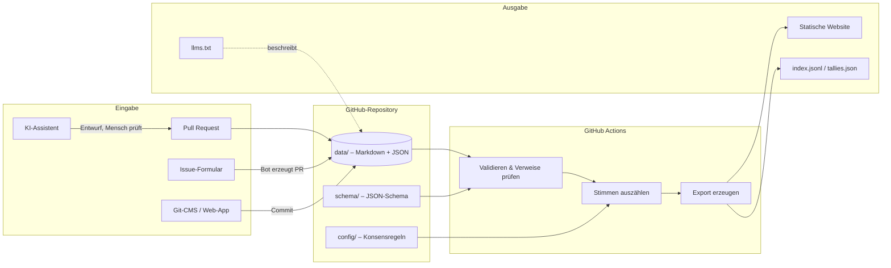
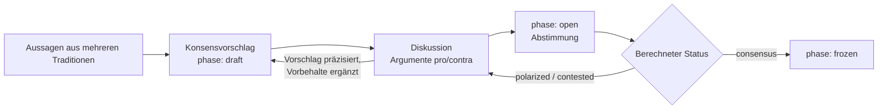

# OpenReligion – Konzept und Evaluation

Stand: 2026-11-17 · Status: Entwurf zur Diskussion

Dieses Dokument bewertet, wie sich Daten-, Religions- und Konsensschicht zu einer
Plattform für öffentlichen religiösen Diskurs verbinden lassen, und gibt zu jeder
Frage eine Empfehlung. Die konkrete Datenstruktur steht in [datenmodell.md](datenmodell.md),
ein lauffähiges Beispiel unter [`data/`](../data).

## Kurzfassung

| Frage | Empfehlung |
|---|---|
| Gesamtarchitektur | **Git-Repository als einzige Datenquelle**, GitHub Actions als Prüf- und Rechenschicht, statische Website + JSON-Export als Lesezugang. Später eine Web-App, die in dasselbe Repo schreibt. |
| Dateiformat | **Markdown mit YAML-Frontmatter** für alles, was Menschen schreiben; **JSON** für Volltexte, Stimmen, Konfiguration und alle generierten Daten. Ein JSON-Schema pro Typ prüft beides. |
| Religionsschicht | Der vorgegebene **Baum** (Monotheismus → göttliche Instanz / Widersacher, Polytheismus, Sonstiges, Wissenschaft) für die Navigation und Gruppenbildung, ergänzt um **Facetten** für alles, was nicht sauber passt. |
| Konsens | **Brücken-Konsens statt Mehrheit**: Ein Vorschlag gilt nur als Konsens, wenn *jede* Gruppe mehrheitlich zustimmt. Dissens ist ein eigenes, gültiges Ergebnis. |
| Abstimmen | **Zwei Achsen**: „Stimme ich zu?“ und „Ist das korrekt dargestellt?“. Stimmen liegen als eine JSON-Datei pro Person im Repo; CI erlaubt nur Änderungen an der eigenen Datei. |
| Eingabe | Stufenweise: Pull Request → Issue-Formulare mit Bot → Git-basiertes CMS → eigene Web-App. KI-gestützte Erfassung mit menschlicher Prüfung. |
| KI-Lesbarkeit | Deterministische IDs ↔ Pfade, kontrollierte Vokabulare, **Zuschreibung in jedem Datensatz** („Laut Islam …“), generierter JSONL-Export und `llms.txt`. |

## 1. Leitprinzipien

Die Prinzipien entscheiden die Konflikte, die die Technik nicht entscheiden kann.

1. **Zuschreibung statt Wahrheitsbehauptung.** Die Plattform behauptet nie „Gott ist dreieinig“,
   sondern „Laut Christentum (Selbstbeschreibung) gilt: …“. Jede Aussage trägt Tradition und
   Perspektive. Das schützt vor Vereinnahmung und verhindert, dass eine KI Glaubenssätze als
   Tatsachen wiedergibt.
2. **Selbstbeschreibung hat Vorrang.** Wie eine Tradition dargestellt wird, prüfen zuerst
   Angehörige dieser Tradition (Korrektheitsstimme, Kurator:innen-Review). Fremdbeschreibungen
   sind erlaubt, aber als `perspective: external` markiert.
3. **Dissens ist ein Ergebnis.** „Wir sind uns einig, worin wir uneinig sind“ ist ein vollwertiger
   Konsens (`documented-dissent`). Er ist bei metaphysischen Fragen das realistische Ziel.
4. **Keine Mehrheit über Minderheiten.** Die größte Gruppe darf keinen Konsens erzwingen.
5. **Alles ist nachvollziehbar.** Jede Änderung ist ein Commit, jede Stimme ist zählbar,
   jede Berechnung ist ein Skript im Repo.

## 2. Gesamtarchitektur



### Bewertete Architekturvarianten

| Variante | Stärken | Schwächen | Bewertung |
|---|---|---|---|
| **A. Rein GitHub** (Repo + Actions + Pages) | Keine Server, volle Transparenz, Review über PRs, kostenlos | Eingabe ohne Git-Kenntnisse mühsam, Stimmen öffentlich, Echtzeit fehlt | **Start (Phase 1–2)** |
| **B. Hybrid** (Repo bleibt Quelle, Web-App schreibt per Bot-Commits) | Gute Bedienung, Daten bleiben offen und versioniert, Login über GitHub-OAuth | Eine App muss betrieben werden | **Ziel (Phase 3)** |
| **C. Datenbank zuerst** (z. B. Wikibase, Decidim, Discourse) mit Git-Export | Fertige Funktionen für Beteiligung oder Wissensgraphen | Git ist nur noch Kopie; Review- und Versionierungsmodell geht verloren; schwer zu forken | Nicht empfohlen |

Variante B wächst ohne Bruch aus A, weil sich das Datenformat nicht ändert – nur der Weg,
auf dem Dateien entstehen.

## 3. Datenschicht

### Formatoptionen

| Option | Menschenlesbar | KI-lesbar | Git-Diffs | Bewertung |
|---|---|---|---|---|
| Reines JSON für alles | mäßig (lange Texte in Strings, Escapes) | sehr gut | schlecht bei Prosa | nur für maschinennahe Daten |
| JSON + separate `.md` je Eintrag | gut | gut | gut | doppelte Dateien laufen auseinander |
| **Markdown + YAML-Frontmatter** | sehr gut – GitHub zeigt Frontmatter als Tabelle | sehr gut (strukturiert + Prosa) | sehr gut | **für Inhalte** |
| JSON-LD / RDF | gering | sehr gut für Linked Data | mäßig | nur als optionaler Export |
| Datenbank (SQLite o. ä.) im Repo | nein | gut | binär, keine Diffs | nein |

**Empfehlung:** Inhalte (Traditionen, Werke, Aussagen, Auslegungen, Argumente,
Konsensvorschläge) als **Markdown mit YAML-Frontmatter**, eine Datei pro Eintrag.
Volltexte, Stimmen, Konfiguration und alle generierten Daten als **JSON**.
YAML-Frontmatter wird beim Laden in JSON übersetzt und mit demselben JSON-Schema geprüft;
der Validator lässt dabei nur JSON-kompatible Typen zu (Datumswerte bleiben Strings,
nur `true`/`false` sind Wahrheitswerte).

### Organisation im Repo

- **Eine Datei pro Eintrag.** Wenig Merge-Konflikte, jede Datei hat eine eigene Historie.
- **ID = Pfad.** `claim:christianity/golden-rule` liegt immer in
  `data/claims/christianity/golden-rule.md`. Mensch und KI finden jede Datei ohne Index.
- **IDs werden nie wiederverwendet.** Ersetzte Einträge bekommen `review_status: deprecated`
  und `superseded_by`.
- **Generiertes liegt nicht im Hauptzweig.** `dist/` entsteht in CI und wird über GitHub Pages
  veröffentlicht, damit Commits nicht von Bot-Rauschen überdeckt werden.
- **Größe:** Ein vollständiger Bibeltext liegt bei wenigen MB JSON. GitHub verkraftet viele
  Tausend solcher Dateien; bei sehr großen Korpora gehören Volltexte in ein eigenes Repo
  (`openreligion-texts`), auf das das Haupt-Repo per Stellenangabe verweist.

## 4. Religionsschicht

### Taxonomie

Die vorgegebene Struktur wird als Baum aus Kategorien abgebildet:

```
Monotheismus
├── Glaube an die göttliche Instanz   (Judentum, Christentum, Islam, …)
└── Glaube an den Widersacher         (theistischer Satanismus)
Polytheismus                          (Hinduismus*, …)
Sonstiges                             (Buddhismus, Daoismus, Animismus, säkularer Humanismus, …)
Belegte Fakten (Wissenschaft)
```

Die fünf Blätter dieser Struktur sind zugleich die **Gruppen der Konsensberechnung**
(festgelegt in [`config/consensus.json`](../config/consensus.json)).

### Das Einordnungsproblem und die Lösung über Facetten

Ein strenger Baum zwingt zu Entscheidungen, die Angehörige oft ablehnen:

| Fall | Problem | Lösung im Modell |
|---|---|---|
| Hinduismus | poly-, heno-, monotheistische und monistische Strömungen | primär `parent: polytheism`, `facets.theism` mit allen Ausprägungen, `also_in: other`; Strömungen können eigene `parent` haben |
| Buddhismus | kein Schöpfergott, aber Gottheiten in manchen Strömungen | `other`, `facets.theism: [nontheism]` |
| Satanismus | theistisch (Wesen) vs. symbolisch/atheistisch | nur theistisch unter *Widersacher*; symbolisch unter *Sonstiges* mit `facets.theism: [atheism]` |
| Satan/Iblis in Christentum und Islam | Widersacher kommt in der Lehre vor | Lehre über den Widersacher ≠ Ausrichtung auf ihn → Aussagen der jeweiligen Tradition |
| Zoroastrismus | Monotheismus mit dualistischer Kosmologie | *göttliche Instanz*, `facets.theism: [monotheism, dualism]` |
| Wissenschaft | keine Religion und nicht gleich Atheismus | eigene Kategorie mit `epistemic_basis: empirical`; Aussagen brauchen Evidenzgrad und Quellen |

Der Baum bleibt also die gemeinsame Navigation; Facetten tragen die Nuancen.
Änderungen an der Taxonomie selbst laufen als Konsensvorschlag.

### Aussagetypen

Nicht jede Aussage kann gleich behandelt werden. Jede Aussage hat einen `claim_type`:

| Typ | Beispiel | Realistisches Konsensziel |
|---|---|---|
| `descriptive` | „Der Islam lehrt die Einheit Gottes.“ | Konsens über die **Korrektheit der Beschreibung** – auch Nicht-Muslime können zustimmen |
| `normative` | „Behandle andere, wie du behandelt werden willst.“ | gemeinsame Werte (`shared-value`) |
| `metaphysical` | „Gott ist einer in drei Personen.“ | meist `documented-dissent` |
| `empirical` | „Kooperation ist evolutionär stabil.“ | `factual`, gestützt auf Evidenz |
| `historical` | „Das Konzil von Nicäa fand 325 statt.“ | `factual` |

## 5. Konsensschicht

### Ablauf



Bei `documented-dissent` wird nicht über die Wahrheit der Positionen abgestimmt, sondern
darüber, ob der Dissens korrekt und fair beschrieben ist – derselbe Ablauf, anderes Ziel.

Diskussion findet frei in **GitHub Discussions** statt; was daraus an Substanz entsteht,
wird als **Argument** (`pro`/`contra`) ins Repo übernommen und verlinkt. Ein Contra-Argument
muss einen Konsens nicht verhindern – im Beispiel hat es zu den `reservations` im
Goldene-Regel-Vorschlag geführt.

### Warum nicht einfach Mehrheit?

| Verfahren | Problem bei religiösem Diskurs |
|---|---|
| Einfache Mehrheit | Die größte Gemeinschaft bestimmt den „Konsens“ aller |
| Gewichtete Mehrheit pro Tradition | Gewichte sind politisch und angreifbar |
| Einstimmigkeit | Eine einzelne Stimme blockiert alles |
| Liquid Democracy | Delegationen konzentrieren Macht; schwer erklärbar |
| **Brücken-Konsens** (Prinzip wie bei Community Notes oder Polis) | Ein Vorschlag braucht Zustimmung **in jeder Gruppe**. Belohnt Formulierungen, die Gräben überbrücken |

### Der Algorithmus

Für jedes abstimmbare Element und jede Gruppe *g* (die fünf Bereiche):

1. Zustimmung *a*, Ablehnung *d* zählen („pass“ zählt nicht).
2. Geglättete Zustimmung `score_g = (a + 1) / (a + d + 2)` – kleine Gruppen landen nahe 0,5
   statt bei 0 oder 1.
3. Nur Gruppen mit mindestens `min_group_votes` Stimmen zählen.
4. **Brückenwert = kleinster `score_g`** aller zählenden Gruppen.
5. Status:

| Status | Bedingung (Schwellen in `config/consensus.json`) |
|---|---|
| `consensus` | Brückenwert ≥ 0,7 **und alle** Gruppen zählen |
| `provisional-consensus` | Brückenwert ≥ 0,7, aber mindestens eine Gruppe hat zu wenige Stimmen |
| `converging` | Brückenwert ≥ 0,5 |
| `polarized` | eine Gruppe ≥ 0,7, eine andere ≤ 0,3 |
| `contested` | sonst |
| `rejected` | auch die zustimmungsstärkste Gruppe ≤ 0,3 |
| `insufficient-data` | weniger als 2 Gruppen zählen |

Mit den Demo-Daten ergibt das:

| Element | Status | Brückenwert |
|---|---|---|
| Goldene Regel als gemeinsamer Bestand | `provisional-consensus` (Gruppe *Widersacher* fehlt) | 0,75 |
| Natur des Göttlichen – dokumentierter Dissens | `provisional-consensus` | 0,75 |
| Auslegung Mt 7,12 „gleichwertige Fassungen“ | `polarized` | 0,25 |
| Auslegung Mt 7,12 „positive Pflicht“ | `contested` | 0,25 |

**Weiterentwicklung:** Statt selbst angegebener Zugehörigkeit lassen sich Gruppen auch aus dem
Abstimmungsverhalten berechnen (Clustering wie bei Polis, Matrixfaktorisierung wie bei
Community Notes). Vorteil: Niemand muss seine Religion angeben. Nachteil: schwerer
nachvollziehbar. Empfehlung: zunächst selbst angegebene Gruppen; Clustering als zweite,
vergleichende Auswertung, sobald es genug Stimmen gibt.

### Zwei Abstimmungsachsen

| Achse | Frage | Wer zählt besonders |
|---|---|---|
| `stance` (agree / disagree / pass) | Stimme ich dem zu? | alle Gruppen → Brücken-Konsens |
| `accuracy` (accurate / inaccurate / unsure) | Ist das sachlich korrekt dargestellt – unabhängig davon, ob ich es glaube? | getrennt ausgewiesen: Angehörige der Tradition (`self`) und Außenstehende (`external`) |

Damit kann eine Muslimin bestätigen, dass die Trinitätslehre korrekt beschrieben ist,
ohne ihr zuzustimmen – genau die Art Anerkennung, auf der ein öffentlicher Diskurs aufbaut.

### Auslegungen

Konkurrierende Auslegungen derselben Stelle haben dasselbe `target` und werden einzeln
abgestimmt. Angezeigt werden beide Werte: Zustimmung innerhalb der Tradition (Lesart der
Gemeinschaft) und Brückenwert (übergreifende Akzeptanz). Eine Auslegung muss nicht
übergreifend akzeptiert sein, um innerhalb ihrer Tradition maßgeblich zu sein.

## 6. Dateneingabe

| Weg | Zielgruppe | Aufwand | Wann |
|---|---|---|---|
| **Pull Request** mit Vorlagen aus `templates/` | Git-Kundige, Kurator:innen | keiner | sofort |
| **GitHub-Weboberfläche** („Add file“, Datei bearbeiten) | Gelegenheitsbeitragende | keiner | sofort |
| **Issue-Formulare** (`.github/ISSUE_TEMPLATE/*.yml`) + Action, die daraus einen PR mit fertiger Datei erzeugt | alle mit GitHub-Konto | klein (ein Skript) | Phase 2 |
| **Git-basiertes CMS** (Decap CMS, TinaCMS) auf der Website | Redaktion ohne Git-Kenntnisse | mittel (OAuth-Proxy für GitHub nötig) | Phase 2–3 |
| **Eigene Web-App** mit GitHub-Login, schreibt über einen Bot | breite Öffentlichkeit, Abstimmen mit einem Klick | hoch | Phase 3 |
| **KI-Assistent**: Freitext oder Quelle → schemakonformer Entwurf → PR | alle | mittel | Phase 2 |
| **Massenimport** von Textkorpora per Skript | Maintainer | mittel je Quelle | laufend |

**KI-gestützte Eingabe** ist besonders hilfreich, weil das Schema streng und gut beschrieben
ist: Ein Modell erhält Schema + Vorlage + Freitext und erzeugt einen Entwurf mit
`review_status: draft`. Regeln: Die KI erzeugt nur PRs, nie direkte Commits; Zitate werden
gegen den Korpus geprüft; Zuschreibungen (`tradition`, `perspective`) bestätigt ein Mensch.

## 7. Religiöse Texte

### Quellen und Lizenzen

Die Lizenz ist die harte Grenze: Viele moderne Übersetzungen sind urheberrechtlich geschützt.
Jede Ausgabe trägt deshalb ein Pflichtfeld `license`; `reference-only` bedeutet: nur
Stellenangaben, kein Volltext. Der Validator verweigert Volltexte solcher Ausgaben.

| Quelle | Inhalt | Lizenzlage (vor Import jeweils prüfen) |
|---|---|---|
| CrossWire SWORD, eBible.org | Bibelausgaben, darunter KJV, Luther 1912 | ältere Ausgaben gemeinfrei |
| Sefaria | jüdische Texte (Tanach, Talmud, Kommentare) | je Text unterschiedlich (gemeinfrei bis CC BY-NC) |
| Tanzil | Korantext (arabisch) | eigene Lizenz: Weitergabe erlaubt, Text unverändert |
| SuttaCentral | Pali-Kanon mit Übersetzungen | Übersetzungen von Bhikkhu Sujato CC0 |
| sacred-texts.com u. ä. | ältere Übersetzungen vieler Traditionen | überwiegend gemeinfreie Vorlagen |
| Lutherbibel 2017, Einheitsübersetzung 2016 | moderne deutsche Bibeln | geschützt → `reference-only` |

### Referenzsystem

Stellen werden als `<werk>#<locus>` angegeben, z. B. `work:bible#Matt.7.12`,
`work:quran#112.1-4`, `work:bavli#Shabbat.31a`. Jedes Werk legt sein Zitierschema als
regulären Ausdruck fest (`citation.locus_pattern`) und lehnt sich an etablierte Standards an
(OSIS für die Bibel, Sefaria-Schreibweise für rabbinische Texte, SuttaCentral für den
Pali-Kanon). Der Validator prüft jede Stellenangabe im ganzen Repo gegen dieses Muster.

Volltexte liegen pro Ausgabe und Abschnitt in JSON; jedes Segment trägt den vollen Locus,
damit jede Zeile allein auffindbar ist (`grep "Matt.7.12"` genügt).

## 8. Abstimmen: Optionen, Manipulation, Datenschutz

### Wo werden Stimmen gespeichert?

| Option | Transparenz | Manipulationsschutz | Datenschutz | Aufwand |
|---|---|---|---|---|
| **A. Eine JSON-Datei pro Person im Repo**, Änderung nur durch die Person selbst (CI-Prüfung) | vollständig | GitHub-Konto als Identität | Stimmen öffentlich | sehr klein |
| B. Reaktionen in GitHub Discussions, Action aggregiert | hoch | GitHub-Konto | öffentlich | klein, aber nur 👍/👎, keine zwei Achsen |
| C. Web-App mit Datenbank, ins Repo gehen nur Aggregate | Ergebnisse ja, Einzelstimmen nein | App-Login | **gut** (Mindestgruppengröße für Veröffentlichung) | hoch |
| D. Kryptografisch signierte Stimmen (SSH-/GPG-signierte Commits) | vollständig | sehr hoch | öffentlich | mittel, für Laien schwer |

**Empfehlung:** Mit **A** starten – das ist im Beispiel umgesetzt
([`data/participants/`](../data/participants), Prüfschritt in
[`.github/workflows/validate.yml`](../.github/workflows/validate.yml)).
Für die breite Öffentlichkeit auf **C** umstellen. Das Format von `tallies.json` bleibt dabei
gleich, sodass Website und KI-Export nichts merken.

### Manipulation (Sybil-Angriffe)

- Mindestalter und Mindestaktivität von GitHub-Konten als Bedingung für zählende Stimmen.
- Brücken-Konsens dämpft Massenstimmen: Viele Konten in einer Gruppe heben deren Score,
  aber nicht den Brückenwert.
- Auffällige Muster (viele neue Konten, identische Stimmen) markieren statt still löschen.
- Für hohe Verbindlichkeit: verifizierte Kurator:innen pro Tradition mit eigener, getrennt
  ausgewiesener Korrektheitsstimme.

### Datenschutz – wichtig

Angaben zur religiösen Überzeugung sind nach **DSGVO Art. 9** besonders geschützte Daten.
Option A macht Zugehörigkeit und Abstimmungsverhalten öffentlich und dauerhaft (Git-Historie).
Deshalb im Modell:

- Zugehörigkeit ist **freiwillig**; ohne Angabe zählt die Stimme nur in der Gesamtsumme.
- Pflichtfeld `consent.public_participation: true` mit Datum – ohne Einwilligung keine gültige Datei.
- Pseudonyme GitHub-Konten ausdrücklich erlaubt und empfohlen.
- Löschanträge müssen auch die Git-Historie betreffen können – das spricht mittelfristig für Option C.

Vor dem öffentlichen Start sollte das rechtlich geprüft werden.

## 9. KI-Lesbarkeit

| Maßnahme | Nutzen |
|---|---|
| ID ↔ Pfad deterministisch | Eine KI kann jede Datei ohne Suche öffnen |
| Ein Eintrag pro Datei, Frontmatter zuerst | Natürliche Chunk-Grenzen für RAG; Metadaten vor Prosa |
| Kontrollierte Vokabulare (`claim_type`, `perspective`, `stance` …) | Filterbar, keine Synonym-Raterei |
| Strenge Schemas (`additionalProperties: false`) | Tippfehler und erfundene Felder fallen sofort auf – auch bei KI-erzeugten Entwürfen |
| **Zuschreibungssatz** `framed` im Export | Jeder Datensatz ist allein verständlich: „Laut Islam (Selbstbeschreibung): …“, „Wissenschaftlicher Befund (Evidenzgrad: supported): …“ |
| Relationen explizit und typisiert, Gegenrichtung im Export ergänzt | Wissensgraph ohne Inferenz |
| Mehrsprachige Felder mit Sprachcodes | Mehrsprachige Modelle wählen die passende Sprache |
| Externe Kennungen (Wikidata) | Verknüpfung mit bestehendem Weltwissen |
| `dist/index.jsonl` (eine Zeile pro Eintrag) und `llms.txt` | Direkt für Embeddings, Fine-Tuning und Agenten nutzbar |

## 10. Governance

- **Kurator:innen pro Tradition** über `CODEOWNERS`: Änderungen an Aussagen einer Tradition
  brauchen ein Review aus dieser Tradition. Beispiel:
  ```
  /data/claims/islam/        @<org>/kuratorinnen-islam
  /data/traditions/          @<org>/taxonomie
  /config/                   @<org>/maintainer
  ```
- **Neutrale Maintainer** für Schema, Konfiguration und Konfliktfälle.
- **Verhaltenskodex**: Kritik an Positionen ist erlaubt, Herabwürdigung von Personen nicht.
- **Änderungen an Regeln** (Schwellen, Gruppen, Taxonomie) selbst nur per Konsensvorschlag.

## 11. Risiken und offene Fragen

| Risiko | Gegenmaßnahme |
|---|---|
| Kleine Gruppen (z. B. *Widersacher*) blockieren dauerhaft vollen Konsens | Status `provisional-consensus`; Mindeststimmen pro Gruppe; ggf. Gruppen zusammenlegen – per Konsensentscheid |
| Brigading durch organisierte Gruppen | Brücken-Konsens, Kontenkriterien, Transparenz |
| Streit über Einordnung in der Taxonomie | Facetten, `also_in`, Taxonomie-Änderungen per Konsens |
| Missbrauch als Missionierungsplattform | Zuschreibungspflicht, Verhaltenskodex, Moderation |
| Urheberrecht an Übersetzungen | Lizenzpflichtfeld, `reference-only`, CI-Prüfung |
| Datenschutz der Teilnehmenden | Einwilligungspflicht, Pseudonyme, später Option C |

Offene Entscheidungen: Hauptsprache der Inhalte (Vorschlag: Deutsch und Englisch parallel),
Mindeststimmen im Echtbetrieb (Vorschlag ≥ 10 pro Gruppe), ob Kurator:innen-Korrektheitsstimmen
mehr Gewicht bekommen als andere.

## 12. Fahrplan

| Phase | Inhalt | Ergebnis |
|---|---|---|
| **1 – Fundament** *(dieses Repo)* | Schemas, Validator, Konsensberechnung, Beispieldaten, CI | prüfbares Datenmodell |
| 2 – Beteiligung | Issue-Formulare + Bot, statische Website (Astro/Eleventy) auf GitHub Pages, Discussions, CODEOWNERS, Korpusimport für 2–3 Werke | erste echte Beitragende |
| 3 – Öffentlichkeit | Web-App mit GitHub-Login und Ein-Klick-Abstimmung, Stimmenspeicherung nach Option C, Clustering-Auswertung | breite Teilnahme |
| 4 – Vernetzung | JSON-LD-Export, Wikidata-Abgleich, öffentliche API, MCP-Server für KI-Agenten | Nachnutzung durch Dritte |
